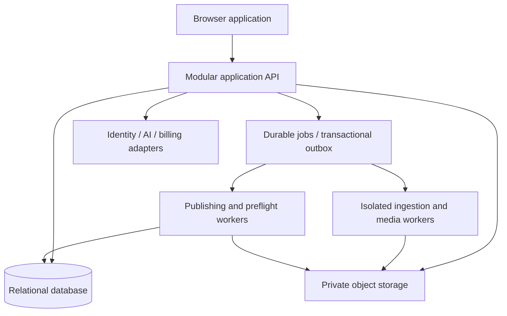

# Phase 2 — Domain and system architecture

Input: [Phase 1](PHASE_1_ANALYSIS.md), read from disk. Status labels apply to architecture, not purchased or installed technology. CONFIRMED means required by current instructions/product invariants; RECOMMENDED means reasoned default; TENTATIVE means competing options remain; RESEARCH REQUIRED means a feasibility or evidence gate blocks adoption.

## Refined domain boundaries

| Module | Owns | Boundary and collaboration |
|---|---|---|
| Access and organization | User identity link, organization, membership, publication grants, roles | Authentication delegated to an identity provider; Pageinator owns business authorization. Billing ownership does not grant editorial release rights. |
| Publication configuration | Publication, versioned profile, brand, sections, template catalogue, print-profile references | Brand/editorial configuration is separate from validated press configuration; editions pin versions. |
| Editorial content | Story identity, immutable StoryRevision, asset associations, captions/credits, editorial status | Edition placements reference selected revisions, not a globally mutable story body. |
| Asset and rights | Original assets, derivatives, source provenance, rights grants, permitted uses | A shared rights service covers articles, photos, fonts and ads; it is not a synonym for copyright certainty. |
| Discovery/intelligence | ContentSource connectors, ingested source items, NewsSource identities, NewsEvent clusters, analysis | External observations are not publishable StoryRevisions until selected with sufficient rights and editorial approval. |
| Edition planning and document | Edition, sections, content selection, ad reservations, EditableDocument and revisions | Ad contracts constrain placement; do not build a sales/finance CRM. Document revision is the editing consistency boundary. |
| Publishing engine | Layout, typography, composition, ResolvedDocument and validation | Internal library/process boundary; has no direct authority to change customer content or release output. |
| Editor | Commands, selections, handles, story editing, undo, review and proposal UX | Owns transient interaction state, not a second authoritative publishing model. |
| Production and release | PrintProfile versions, export/preflight jobs, approvals, released artifact identity | Binds exact revision, resolution manifest, final PDF hash and preflight report. |
| Archive | Immutable edition packages, retrieval, restoration/copy, retention | Search is a projection; storage is an adapter. Archive truth survives index loss. |
| Commercial operations | Subscription, entitlements, metered usage, StorageUsage ledger | Billing provider owns payment processing; Pageinator calculates auditable domain usage. |
| Platform | Storage, jobs, audit, observability, integration secrets, backup/recovery | Cross-cutting infrastructure; do not make each a microservice. |

Authentication/identity and authorization are related but separate responsibilities. Layout, composition and typography are collaborating engine stages, not independently networked services. Search/indexing and audit are projections/infrastructure rather than owners of stories. Colour conversion belongs to a common rendering/asset pipeline; PrintProfile owns policy. AI Editorial is an adapter-backed capability serving content and layout proposals, not a parallel system of record.

## Recommended deployment shape

One application codebase and relational transactional boundary, plus worker process classes for expensive or untrusted inputs. Shared versioned domain contracts allow separate runtime dependencies without service proliferation. APIs acknowledge persisted work and expose job status; worker failure never becomes silent success. Native publishing engines may run as isolated executables with structured inputs/results. Browser delivery through static hosting/CDN is a recommendation; customer documents and signed private artifacts must not be publicly cached.

## Architecture choices

| Choice | Status | Reason / reconsideration trigger |
|---|---|---|
| Browser-first, human editorial authority, deterministic physical checks | CONFIRMED | R03/R15/R16; not tied to a framework |
| Tenant-scoped canonical records and exact-revision exports | CONFIRMED | R06/R28/R34/R36 |
| Modular monolith with durable workers | RECOMMENDED | Few initial teams, strong transactional workflow, unknown scale; split only measured workload/security ownership boundaries |
| PostgreSQL for transactional state | RECOMMENDED | Transactions, constraints and RLS; candidate registry must validate operations/provider |
| Object storage for large immutable bytes | RECOMMENDED | Database stores authorized references/manifests, not whole image/PDF histories |
| React/TypeScript/Vite for UI | RECOMMENDED | Fits browser product and contract-driven mocks; not locked by context |
| FastAPI/Python control plane | TENTATIVE | Good fit for ingestion; compare team skills and one-language TypeScript option before backend foundation |
| Native/WASM common engine | RESEARCH REQUIRED | Same algorithm source does not itself establish cross-platform numeric/font parity |
| Server-authoritative resolved output | RECOMMENDED | Reproducible environment and controlled fonts; latency/cost experiment required |
| Queue implementation and hosting provider | TENTATIVE | Select after runtime/workload decisions; no custom durable queue |
| Shared-schema multi-tenancy with RLS defense | RECOMMENDED | Simpler initial operations; dedicated enterprise isolation deferred |
| Real-time CRDT collaborative document | RESEARCH REQUIRED | Not necessary for initial workflow; optimistic concurrency plus document edit lease is initial proposal |

The monolith is not one undifferentiated package: modules expose commands/queries, prohibit arbitrary writes to another module's tables and emit durable domain events. Database/outbox commit occurs together. Workers accept at-least-once delivery, use idempotency keys, bounded retries, leases, heartbeats, dead-letter states and cancellation. Concurrent completion checks the expected revision/job generation before publishing a result. CPU-heavy jobs do not run inside request handlers; worker memory/process behavior must be sized explicitly ([FastAPI deployment concepts](https://fastapi.tiangolo.com/deployment/concepts/)).

## Principal interactions

CreateEdition snapshots selected profile/template/print-profile versions. SelectContent records the exact source/story revisions and rights grant. EditDocument applies a validated command against a base revision and yields a new revision. ResolveDocument consumes that immutable snapshot and an engine manifest. RequestExport snapshots resolution and profile identities; preflight binds to resulting bytes. ReleaseEdition requires current authorization, fresh rights checks and passing mandatory checks; archive completion is part of the durable release protocol. Retries reuse the existing release identifier.

Do not use distributed transactions between the database and storage. Stage immutable objects, verify digests, commit a manifest, and recover orphaned staged data through reconciliation. The release state machine must make partial failure visible.

## Security and scale from the beginning

Every request, queued job, storage key mapping and search projection carries organization scope. Publication access is an additional constraint. RLS is defense in depth, not a substitute for application authorization; PostgreSQL owners/superusers can bypass policies unless roles are arranged deliberately ([PostgreSQL row security](https://www.postgresql.org/docs/17/ddl-rowsecurity.html)). Use non-owner application roles, scoped transactions and adversarial tests.

Bound uploads, crawling, decompression, generation time, PDF parsing and AI usage per tenant. Record correlation IDs and job provenance without logging full unpublished content. Start with relational full-text/metadata search; specialized multilingual indexing and vector search are later evidence-driven choices. Defer service mesh, Kubernetes, Kafka, event sourcing of the entire product and independent databases per module until justified.

Open issues passed forward: pilot presses/languages/fonts, renderer/PDF writer, professional preflight procurement, collaboration expectations, retention, rights contracts, deployment region, runtime and performance budgets. None blocks documenting or building the authorized UI simulation later.
